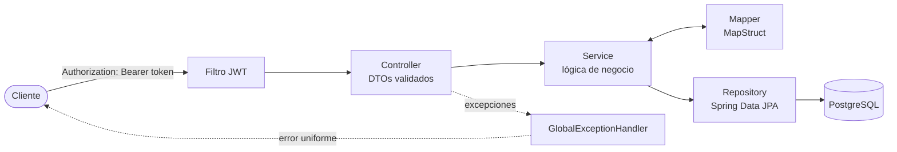
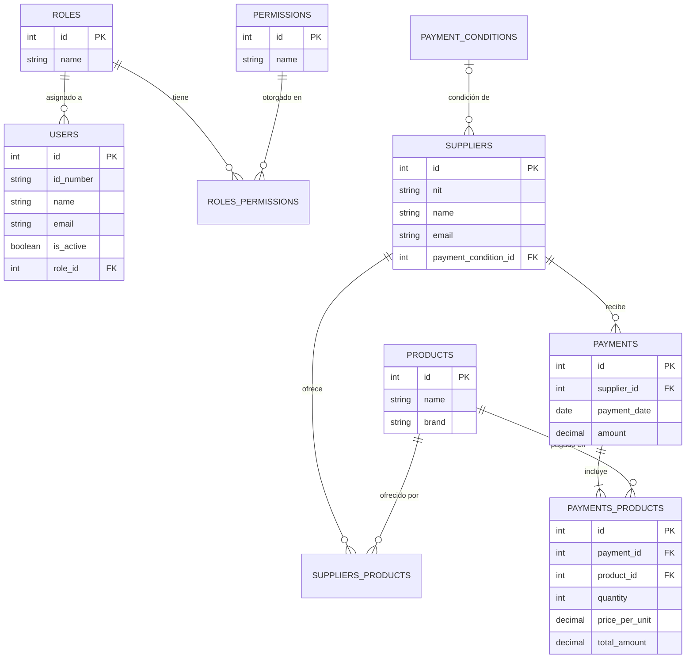

# PetManager - Backend

> API REST para la gestión de tiendas de mascotas: usuarios y roles, proveedores, productos y pagos, con autenticación JWT.

Proyecto desarrollado en equipo en **Fábrica Escuela** (Universidad de Antioquia), un programa académico donde equipos de estudiantes construyen software con Scrum. Este repositorio es un fork del [repositorio original del equipo](https://github.com/MariAgudelo2/petmanager-backend) que incluye pruebas unitarias y correcciones adicionales.

## Tecnologías

Java 21 · Spring Boot 3.5 · Spring Security + JWT · Spring Data JPA / Hibernate · PostgreSQL · MapStruct · Bean Validation · OpenAPI / Swagger · JUnit 5 · Mockito · Maven

## Funcionalidades

- **Autenticación y autorización** con Spring Security y JWT, con roles (ADMIN, MANAGER, EMPLOYEE) y bloqueo de cuenta tras intentos fallidos.
- **Usuarios:** gestión de usuarios y asignación de roles.
- **Proveedores:** CRUD con búsqueda y filtros dinámicos.
- **Productos:** catálogo y relación con proveedores.
- **Pagos:** registro de pagos a proveedores con detalle de productos y condiciones de pago.
- **Errores uniformes:** respuestas de error consistentes con el código HTTP correcto.

## Arquitectura

El código está organizado **por módulo de negocio**, y cada módulo sigue una arquitectura en capas:

```
src/main/java/.../petmanager_backend/
├── auth/        # login, registro, JWT
├── user/        # usuarios y roles
├── supplier/    # proveedores (con filtros dinámicos usando Specifications)
├── product/     # productos
├── payment/     # pagos y condiciones de pago
└── common/      # seguridad y manejo global de excepciones
```



- Los controladores reciben DTOs validados con Bean Validation, y MapStruct hace la conversión entre entidades y DTOs.
- Un `GlobalExceptionHandler` convierte las excepciones en respuestas de error uniformes con el código HTTP correcto.
- Un filtro JWT valida el token en cada petición, excepto en `/api/auth/**`.

### Modelo de datos



## Pruebas

Las pruebas unitarias no necesitan base de datos:

```bash
./mvnw test
```

Resultado: 181 pruebas, 180 exitosas y 1 omitida (`contextLoads`, que requiere PostgreSQL en ejecución).

Cubren servicios, controladores, mappers, el filtro JWT y el manejo de excepciones, y permitieron detectar y corregir errores como:
- el bloqueo de cuenta no se reiniciaba al expirar el tiempo de bloqueo;
- la edición de proveedores ignoraba el cambio de correo;
- un ciclo en `equals`/`hashCode`/`toString` entre las entidades JPA de pagos;
- los parámetros faltantes o inválidos devolvían 500 en lugar de 400.

## Cómo ejecutarlo

**Requisitos:** Java 21 y PostgreSQL (Maven viene incluido con `./mvnw`).

1. Copia `.env.example` a `.env` y ajusta los valores. El proyecto lo lee gracias a `spring.config.import=optional:file:.env[.properties]`.

   | Variable | Descripción |
   |---|---|
   | `DB_HOST` | Host de la base de datos (ej. `localhost`) |
   | `DB_PORT` | Puerto de la base de datos (ej. `5432`) |
   | `DB_NAME` | Nombre de la base de datos (ej. `petmanager`) |
   | `DB_USER` | Usuario de la base de datos |
   | `DB_PASSWORD` | Contraseña del usuario |
   | `JWT_SECRET` | Secreto para firmar los tokens JWT |

2. Crea las tablas y los datos iniciales. El proyecto usa `spring.jpa.hibernate.ddl-auto=validate`, así que Hibernate no crea las tablas: valida que coincidan con las entidades.

   ```bash
   psql -h localhost -U <usuario> -d petmanager -f database/schema.sql
   psql -h localhost -U <usuario> -d petmanager -f database/data.sql
   ```

   `data.sql` crea los roles (IDs 1: ADMIN, 2: MANAGER, 3: EMPLOYEE) y las condiciones de pago.

3. Arranca la aplicación:

   ```bash
   ./mvnw spring-boot:run
   ```

## Uso de la API

Todos los endpoints, **excepto `/api/auth/**`**, requieren un token JWT válido en el header:

```
Authorization: Bearer <token_jwt>
```

La documentación completa está en Swagger mientras la aplicación corre: `http://localhost:8080/swagger-ui/index.html`
